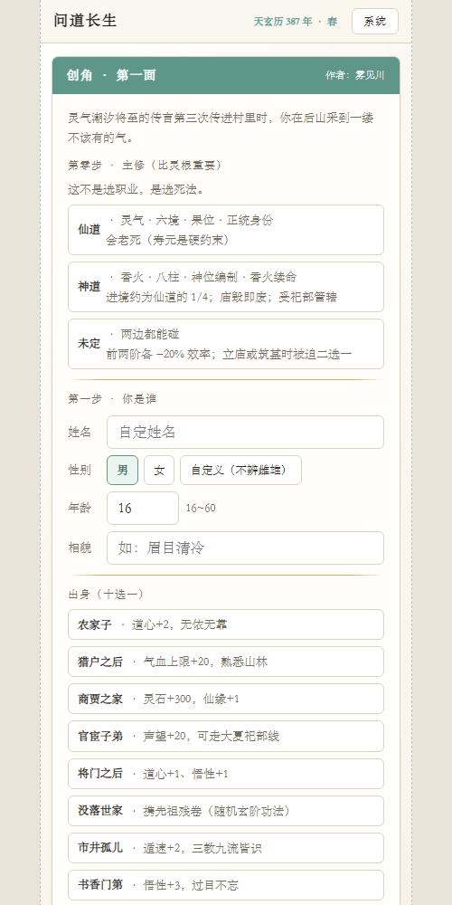
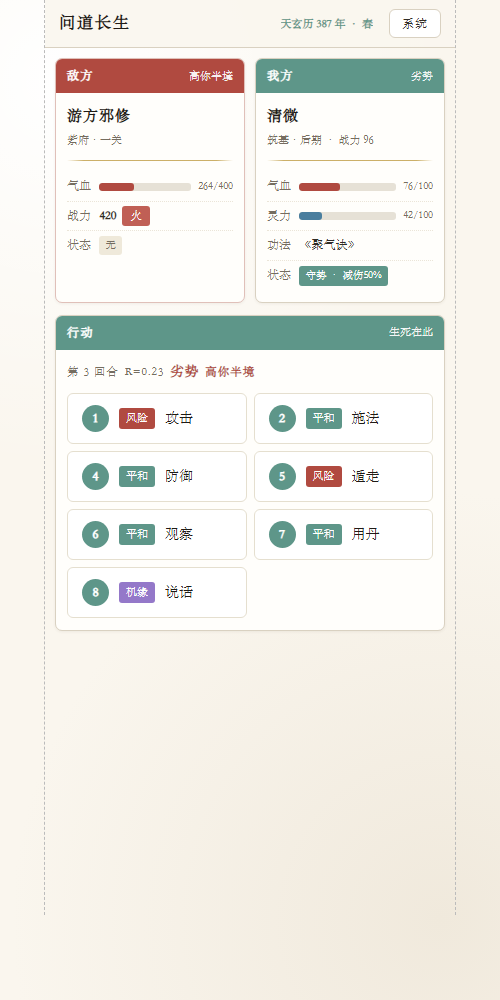

# APK 教程 · 从装软件到手机上玩

> 本文所有 `mobile/...` 路径均以**项目根目录**（`03_v6.2_仙道为主/`）为基准，命令也在该目录执行。

面向：个人自用，不分享、不上架
预计：**40 分钟**（其中 15 分钟是等云端打包）
工程：已备好，在 `D:\wendao-apk`（纯英文路径，直接打开即可）

---

## 〇、全流程一览

```
① 下载 HBuilderX（App开发版）
        ↓  10 分钟
② 解压到 D:\HBuilderX，双击运行
        ↓  5 分钟
③ 注册 DCloud 账号 + 实名认证  ← 最容易卡住的一步
        ↓  1 分钟
④ HBuilderX「打开目录」→ 选 D:\wendao-apk
        ↓  5 分钟
⑤ 双击 manifest.json，配 6 项
        ↓  10 分钟（主要是等）
⑥ 发行 → 原生App-云打包 → 下载 APK
        ↓  5 分钟
⑦ 传到手机，安装，开玩
```

---

## 一、准备清单：要装什么

### 必需（只有两样）

| 软件 | 作用 | 大小 | 来源 |
|---|---|---|---|
| **HBuilderX（App开发版）** | 打包工具，唯一需要安装的软件 | 下载约 400 MB，解压后约 1 GB | `https://www.dcloud.io/hbuilderx.html` |
| **DCloud 账号** | 云打包的账号，免费 | — | HBuilderX 内注册，或 `https://dev.dcloud.net.cn` |

### 不用装（很多人以为要，其实完全不用）

| 常被误认为必需 | 实际 |
|---|---|
| JDK / Java | ❌ 云打包不需要 |
| Android SDK | ❌ 云打包不需要 |
| Android Studio | ❌ 云打包不需要 |
| Node.js / npm | ❌ 不用 |
| 证书生成工具（keytool） | ❌ 选「公共测试证书」即可 |
| 数据线驱动 | ❌ 用微信传 APK 就行 |

### 还要准备的东西

- **一台 Windows 电脑**（你现在这台就够了）
- **一台 Android 手机**（Android 7.0 以上，系统 WebView ≥ 84）
- **传文件的工具**：微信文件传输助手 / QQ / 数据线，任选

> iPhone 用户：APK 打不了，请用 PWA（`手机端实施方案.md` 第六节）。想装到 iPhone 只能买 99 美元/年的开发者账号自签。

---

## 一·补、你的机型：一加 Ace 2（这节重点看）

**结论：完全支持，不用查 WebView，直接往下走。**

| 项 | 实际配置 | 是否满足 |
|---|---|---|
| 系统 | ColorOS 13（Android 13） | ✅ 远超 Android 7 门槛 |
| 系统 WebView | 出厂 110+，随系统更新 | ✅ 远超 84 门槛（36 处 flex gap 全部正常） |
| 屏幕 | 6.74″ · 2772×1240，CSS 视口约 **412×915** | ✅ 正好落在适配区间 |
| 性能 | 骁龙 8+ / 12GB+ | ✅ 纯文本游戏连 1% 都用不到 |

### 这台机器要注意三件事

**① 打包时不要勾「沉浸式状态栏」**

一加 Ace 2 是**左上角挖孔屏**。开了沉浸式之后，顶栏标题会往左上顶，容易被挖孔和状态栏压住。保持默认（让系统状态栏占位）最稳。

**② 安装时要过 ColorOS 的两道拦截**（比原生安卓多一道）

- 第一道「禁止安装未知来源」：
  设置 → 权限与隐私 → 特殊应用权限 → **安装未知应用** → 找到你用来打开 APK 的那个应用（微信 / 文件管理）→ 允许
- 第二道「安全检测」：
  安装时会弹「未经安全检测」或风险提示 → 选 **继续安装 / 仍然安装**

> 公共测试证书是有效签名，不会被判成病毒，这只是 ColorOS 对「非应用商店来源」的常规提醒。

**③ 412px 宽下的实际效果（下面的图就是按你这台的比例生成的）**

创角页：



对战页：



从这两张图可以确认：顶栏三项齐在、输入框不被裁、对战左右并排、血条 `264/400` 不换行、行动按钮两列整齐。

### 这台机器的一个小优势

ColorOS 对后台管理很严，但**这个游戏不需要后台**——纯本地、无网络、无推送。所以既不会被杀后台影响，也几乎不耗电。玩完直接返回桌面就行。

---

## 二、安装 HBuilderX（10 分钟）

### 2.1 下载

1. 浏览器打开 `https://www.dcloud.io/hbuilderx.html`
2. 页面中部有两个下载按钮：**「标准版」** 和 **「App开发版」**
3. **点「App开发版」** ← 一定要这个。标准版不含 App 打包插件，装完还得单独下插件，更麻烦
4. 平台选 **Windows**
5. 下载得到一个 **zip 压缩包**（约 400 MB）

> **怎么判断下载的包够不够用**：解压后看 `HBuilderX\plugins\launcher\base\` 里有没有 `android_base.apk`（约 100 MB）。
> **有 → 打包能力齐全，不需要再装任何插件**。没有 → 是标准版，需要补装或重下。

> ⚠️ 它**没有安装程序**，不是双击下一步那种。下载下来就是个压缩包，这是正常的——HBuilderX 是绿色免安装软件。

### 2.2 解压

1. 右键 zip → 解压到 **`D:\HBuilderX`**
2. 注意两点：
   - **不要解压到 `C:\Program Files`**（权限问题，更新会失败）
   - **不要放在含中文或空格的路径**（例如「桌面\新文件夹」）
3. 解压完，`D:\HBuilderX` 里应该有一个 `HBuilderX.exe`

### 2.3 首次启动

1. 双击 `D:\HBuilderX\HBuilderX.exe`
2. 首次启动可能提示选择主题 → 随便选（浅色更像原游戏的宣纸风）
3. 可能提示"发现新版本" → 可以点稍后，不影响打包

**你应该看到**：左侧「项目管理器」是空的，中间是编辑区，顶部是菜单栏（文件 / 编辑 / 视图 / 发行 / 工具 / 帮助）。

> 如果 Windows 弹「已保护你的电脑」（SmartScreen）：点「更多信息」→「仍要运行」。这是未签名软件的常规提示。

---

## 三、注册 + 实名认证（5 分钟，最容易卡住）

> **为什么必须实名**：DCloud 从 2021 年起，云打包只对实名用户开放。不实名的话，点打包会直接提示「未实名认证，无法使用云打包」。

### 3.1 注册账号

方式一（在 HBuilderX 里）：
右上角有一个「未登录」头像 → 点击 → 选「注册」→ 手机号 + 验证码

方式二（浏览器）：
打开 `https://dev.dcloud.net.cn/` → 右上角「注册」

### 3.2 实名认证

1. 浏览器打开 `https://dev.dcloud.net.cn/`
2. 用刚注册的账号登录
3. 右上角头像 → 「账号中心」/「个人中心」
4. 找到 **「实名认证」** → 选择 **个人认证**
5. 按提示填：真实姓名、身份证号 → 上传身份证正反面 → 人脸识别
6. 提交后一般 **5 分钟内**通过（偶尔要等 1 个工作日）

**怎么确认成功**：账号中心里「实名认证」那一栏会显示「已认证」，而不是「未认证」。

### 3.3 回到 HBuilderX 登录

1. 点右上角头像 → 「登录」
2. 输入刚注册的手机号/密码
3. 登录成功后，头像旁边会显示你的昵称

---

## 四、打开工程（1 分钟）

### 4.1 用哪个目录

**用 `D:\wendao-apk`**。

这个目录我已经准备好了，是纯英文路径。桌面上那个 `开发板\DSH\03_v6.2_仙道为主\...` 路径**含中文**，云打包时有概率报「文件不存在」——所以专门复制了一份到 D 盘。

> 两份内容的同步由 `sync_apk.py` 负责，你改完代码跑一次脚本，两边都会更新。

### 4.2 操作

1. 菜单 **「文件」→「打开目录」**
2. 选中 `D:\wendao-apk`
3. 确定

**你应该看到**：左侧项目树出现 `wendao-apk`，展开后有：

```
manifest.json
index.html
splash.png
icons/
```

并且**项目名旁边有一个 App 小图标**（说明被识别为 5+App 项目）。

> 如果只显示成一个普通文件夹、没有 App 图标 → 说明 `manifest.json` 没被识别。检查它是否和 `index.html` 在同一层。

---

## 五、配置应用信息（5 分钟）

**双击 `manifest.json`**，左侧会展开可视化配置树。按下面 6 项改，其余全部保持默认。

### ① 基础配置

| 字段 | 填什么 |
|---|---|
| 应用名称 | `问道长生` |
| 应用版本名称 | `6.2.0` |
| 应用版本号 | 保持 `622`（数字，每次打包要变大） |
| **AppID** | 点右侧 **「重新获取」** 按钮 → 会弹登录确认 → 自动填入一串 `__UNI__` 或 `HBuilder` 开头的 ID |

> **AppID 是必须的**。留空的话，云打包会直接拒绝。点「重新获取」是最省事的做法（需要已登录）。

### ② 图标配置

1. 点「图标配置」→ 点「浏览」/「选择图片」
2. 选 `D:\wendao-apk\icons\icon-512.png`
3. 点 **「自动生成所有图标并替换」**

生成的图标会在 `unpackage/res/icons/` 下，各尺寸齐全。

### ③ 启动图配置

1. 点「启动图配置」
2. 选「自定义启动图」→ 上传 `D:\wendao-apk\splash.png`
3. 或直接点「自动生成」

> 不配的话会用 HBuilderX 默认启动图（一个 IDE 的 logo），一打开就很出戏。我给的 `splash.png` 是宣纸底 + 青玉环 + 金山纹，和游戏本体一致。

### ④ 屏幕方向

找到「屏幕方向」→ 勾选 **竖屏（portrait-primary）**。

### ⑤ 权限配置

**全部取消勾选，一个都不要。**

这游戏纯离线：不联网、不读通讯录、不定位、不写外部存储。不勾权限的 APK 装起来最干净，手机也不会弹一堆授权框。

> 如果 HBuilderX 默认帮你勾了「网络」之类，取消掉。游戏不需要网络。

### ⑥ 其他

「模块配置」「SDK 配置」「uni-app 相关」——**全部不动**。

最后按 **Ctrl+S** 保存。

---

## 六、云打包（10 分钟，大部分时间在等）

### 6.1 发起打包

菜单 **「发行」→「原生App-云打包」**

### 6.2 弹窗里逐项选

| 项 | 选什么 |
|---|---|
| 平台 | ☑ **Android**（iOS 不要勾） |
| Android 包名 | 保持 `com.wendao.changsheng`（想改就改成 `com.你的名字.wendao`） |
| 证书 | ☑ **使用公共测试证书** ← 个人自用必须选这个，不用自己生成 |
| 渠道包 | 不勾 |
| 广告联盟 | 不勾 |
| 安心打包 | 可勾可不勾 |

点 **「打包」**。

### 6.3 等待

1. 底部「控制台」会开始输出日志：`提交云端打包...`
2. 通常 **3~10 分钟**（高峰期排队会久一点）
3. 完成后日志里会出现 **下载链接**，同时本地 `D:\wendao-apk\unpackage\release\apk\` 下会有 APK 文件

**成功的标志**：控制台最后出现「打包成功」，并给出 apk 路径/链接。

> 免费账号每天有打包次数限制，个人自用完全够；具体额度以 DCloud 官网为准。

---

## 七、装到手机（5 分钟）

### 方式一：微信（推荐，不用线）

1. 电脑微信 → 文件传输助手 → 把 APK 拖进去发送
2. 手机微信打开该文件 → 右上角「…」→「用其他应用打开」→ 选「安装」

### 方式二：数据线

1. 手机连电脑，选「传输文件」
2. 把 APK 复制到手机「Download」目录
3. 手机上用「文件管理」找到它，点开安装

### 安装时的提示

- **「禁止安装未知来源应用」** → 点「设置」→ 允许该来源（微信/文件管理器）安装
- **「应用未安装」** → 见下一节排查

---

## 八、以后更新游戏内容

改完代码后，在这个目录跑两条命令：

```bash
cd "C:\Users\asus\Desktop\开发板\DSH\03_v6.2_仙道为主\mobile"
python build.py
python sync_apk.py
```

`sync_apk.py` 会：
- 把新的 `index.html` 同步到 **两处**（项目内 + `D:\wendao-apk`）
- 把 `versionCode` **自动 +1**（不减的话覆盖安装会失败）

然后回 HBuilderX，重复第 6 节（发行 → 云打包）即可。

---

## 九、故障排查（按你看到的现象查）

| 现象 | 原因 | 解决 |
|---|---|---|
| 点云打包提示**「请先实名认证」** | 账号未实名 | 去 `dev.dcloud.net.cn` 完成实名（第三节） |
| 点云打包提示**「请先获取 AppID」** | manifest 里 AppID 为空 | 双击 manifest.json → 基础配置 → 点「重新获取」 |
| **云打包按钮是灰的** | 没登录 / 没实名 / 当日次数用完 | 检查右上角是否已登录；确认实名状态；明天再试 |
| 打包日志报**「文件不存在」/「路径错误」** | 项目路径含中文 | 用 `D:\wendao-apk`，不要用桌面中文路径 |
| 打包日志报**图标尺寸错误** | 图标没生成 | manifest → 图标配置 → 重新点「自动生成所有图标」 |
| **打开 App 白屏 / 一直转圈** | `index.html` 不在根目录 | 确认 `index.html` 与 `manifest.json` 同级 |
| 打开 App 显示一堆**代码文字** | 页面被当纯文本 | 确认 `index.html` 第一行是 `<!DOCTYPE html>` |
| 安装时**「应用未安装」** | ① 签名不同 ② versionCode 没变大 ③ APK 传坏 | ① 先卸载旧版 ② 跑 `sync_apk.py` ③ 重新下载 |
| 启动图是 HBuilderX 的 logo | 没配启动图 | manifest → 启动图配置 → 上传 `splash.png` |
| 装完**权限弹窗很多** | manifest 里勾了权限 | 权限配置全部取消，重新打包 |
| 界面**按钮挤在一起没间距** | 手机 WebView < 84（不支持 flex gap） | 应用商店更新「Android System WebView」 |
| 打开项目提示**「缺少 App 运行插件」** | 装的是**标准版**，不是 App开发版 | 点「立即安装」在线装（约 1~2 分钟）；或重下 App开发版 |
| 云打包提示**「请升级 HBuilderX」** | 客户端版本过旧 | 菜单「帮助 → 检查更新」升级到最新版 |

---

## 十、装完后的验收清单

**启动**
- [ ] 桌面图标是青玉环 + 金山纹，不是 HBuilderX 默认图标
- [ ] 打开时先看到宣纸底 + 图标的启动图
- [ ] 进入游戏后没有地址栏、没有浏览器 UI

**手感**
- [ ] 创角填名字时，页面**不会突然放大**
- [ ] 点选项按钮有按下反馈，松手后不保持位移
- [ ] 顶栏「系统」按钮能打开存档面板

**对战**
- [ ] 战斗界面左右两张卡并排，敌方在左
- [ ] 气血归零能正常出结算界面（不卡住）

**存档（最关键）**
- [ ] 玩两步 → 完全退出 App → 重开，进度还在
- [ ] 「系统 → 导出存档」能存出 JSON
- [ ] 卸载重装后存档消失（预期行为，不是 bug）

**性能**
- [ ] 点选项到界面刷新无明显延迟
- [ ] 连续玩 20 回合不发烫不卡顿

---

## 附：为什么不用其他打包方式

| 方式 | 你需要额外装 | 评价 |
|---|---|---|
| **HBuilderX 云打包** | 无 | ⭐⭐⭐⭐⭐ 本教程采用，零环境配置 |
| HBuilderX 本地打包 | JDK + Android SDK + Gradle | 要多装 3 样、配 2 小时环境，只有接原生 SDK 才需要 |
| Bubblewrap（Google 官方） | Node + JDK 17 + Android SDK | 给上架 Google Play 用的，个人自用太重 |
| Capacitor | Node + Android Studio | 以后要加原生功能再考虑 |
| 在线 Web2APK 网站 | 无，但需要先把游戏部署到公网 | 免费版有广告/水印 |

---

## 一句话总结

**装一个 HBuilderX，注册一个账号实名，打开 `D:\wendao-apk`，点两次菜单，等十分钟。**

工程、图标、启动图、manifest 都已经配好了，你只需要改 6 个字段然后点打包。

---

*配套文件：`APK打包指南.md`（配置项与原理说明）、`mobile/apk/wendao/`（工程源）、`D:\wendao-apk`（打包副本）。*
