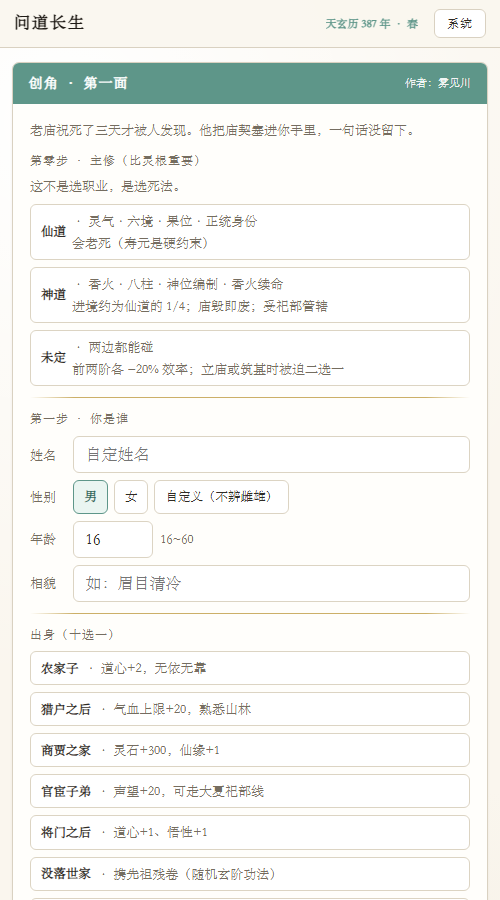
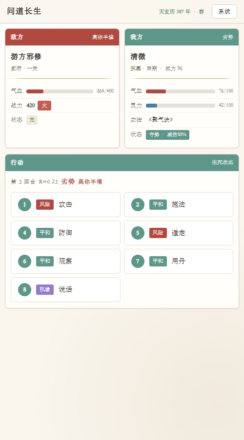
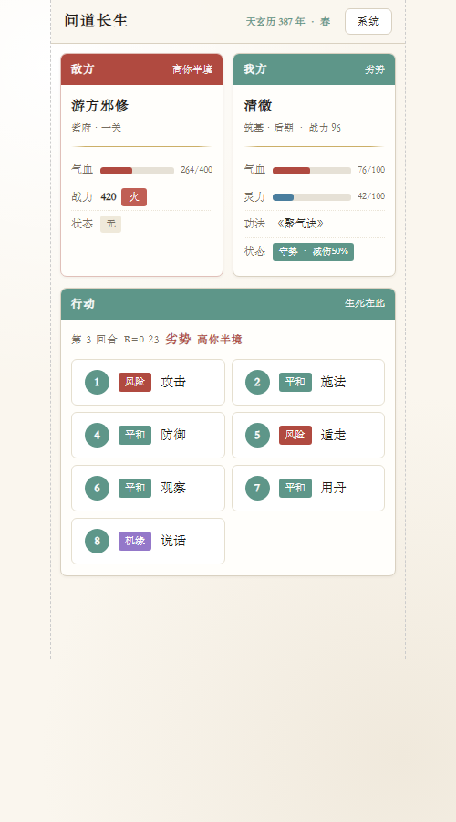

# 手机端实施方案（v6.2 · 已可运行）

> 本文所有 `mobile/...` 路径均以**项目根目录**（`03_v6.2_仙道为主/`）为基准，命令也在该目录执行。

日期：2026-11-08
结论：**能做，而且核心工作已经做完了。** 你只需要跑一条构建命令，再选一个托管方式。

本文不只是评估——`mobile/` 目录里已经是可运行的成品：移动补丁、PWA 三件套、图标、构建脚本、单文件版 `dist/index.html`（210 KB）。

---

## 一、先回答"能不能"

| 判断项 | 实际情况 | 结论 |
|---|---|---|
| 架构 | 纯静态 3 文件，无框架、无后端、无网络请求 | 天然可移植 |
| 渲染 | 纯 DOM + CSS，无 canvas / WebGL | 手机毫无性能压力 |
| 存档 | localStorage + JSON 导出 | 需要额外提示（见 §6.4） |
| 响应式 | 已有 1100 / 880 / 640 / 620 四个断点 | 骨架可用，**细节缺 12 项** |
| 体积 | 源码约 200 KB → 单文件 210 KB | 4G 下 1 秒内打开 |

**一句话：它不是"能不能上手机"，而是"上手机前还差哪几刀"。这 12 刀已经补完了。**

---

## 二、先校正《手机端迁移评估报告》的四处偏差

那份报告方向是对的，但有几处基于旧代码，照它做会踩坑：

| # | 报告说法 | 实际情况 |
|---|---|---|
| 1 | `wxcs3-game.js` 2,391 行 | **已是 2,885 行**（对战双栏 + 卡死修复 + 五行 + 紫府三关都已并入） |
| 2 | "已有断点，作者已预留移动端布局，改造量小" | 断点只是"能堆叠"，**安全区、dvh、hover 粘连、输入框缩放、触控 44px、滚动锁定**六类一个都没处理。真机上会明显别扭 |
| 3 | PWA 用 `data:` URI 内联 manifest | **兼容性差**，部分安卓浏览器直接不识别。已改为独立 `manifest.webmanifest` |
| 4 | "1~2 小时即可上线" | 部署确实只要 10 分钟；但**真机手感打磨 + 验证**实际是 2~3 小时的活，本次已替你做完 |

另外报告里"触控目标偏小"是对的，但它没提到更要命的一条：**iOS 上输入框字号 <16px，聚焦时整页会被放大**，而创角页有 4 个输入框。这条不修，玩家一填名字页面就跳。

---

## 三、真机上真实存在的 12 个问题（已全部处理）

### 3.1 交互类（影响手感，最优先）

| # | 现象 | 原因 | 修法 |
|---|---|---|---|
| 1 | 点选项后按钮保持偏移/高亮 | `.opt:hover{transform:translateX(2px)}` 在触屏上"粘住" | `@media (hover:none)` 内取消 hover，改 `:active` 反馈 |
| 2 | 点按钮有 ~300ms 延迟 | 浏览器等待双击缩放 | `html{touch-action:manipulation}` |
| 3 | 填名字时整页突然放大 | iOS 对 `<16px` 输入框强制 zoom | 窄屏 `input,select{font-size:16px}` |
| 4 | 手指点选项容易点错 | `.opt` 实际高度约 46px，但内边距小 | 触屏 `min-height:44px`（Apple HIG 标准） |
| 5 | 长按选项拖出蓝色选区 | 默认可选文本 | 按钮类 `user-select:none`，正文仍可选 |
| 6 | 手滑下拉就刷新，进度没了 | 未限制 overscroll | `html{overscroll-behavior-y:none}` |

### 3.2 布局类

| # | 现象 | 原因 | 修法 |
|---|---|---|---|
| 7 | 刘海/底部横条遮挡内容 | 缺 `viewport-fit=cover` + `env(safe-area-inset-*)` | 两处都补 |
| 8 | 地址栏伸缩时页面跳动 | `.logbox`、`.modal` 用 `100vh` / `86vh` | 改 `dvh`，用 `@supports` 兜底 |
| 9 | 手机上一进来先看到"纪事"，剧情要往下滚 | 三栏堆叠顺序是 纪事→主面板→状态 | 用 `:not(.stage-fight)` + `order` 把叙事/选项提到第一位 |
| 10 | 对战双栏在窄屏被压成一条 | 原 `@media(max-width:880px){.stage-fight{grid-template-columns:1fr}}` | 窄屏**保持 1fr 1fr**，只压缩内边距与字号 |
| 11 | 顶栏占半屏，时钟被挤没 | 窄屏 `flex-wrap` + 两个 `margin-left:auto` 抢空间 | 640px 下隐藏作者、压缩字号、系统按钮 `flex:0 0 auto` |
| 12 | 弹窗居中留大片空，按钮够不到 | `.modal{align-items:center}` | 窄屏改底部弹起 `align-items:flex-end` |

### 3.3 顺手修掉的两个 bug（做的时候撞出来的）

**① 样式表被提前闭合**
`mobile.css` 的注释里写了 "插到 `</style>` 之前"，Python 无脑拼接后，这一行**直接把 `<style>` 标签闭合了**，后面所有 CSS 变成页面文字。
→ 注释改写 + `build.py` 加断言（发现 `</style` 就报错退出）。这也是给以后留的防呆。

**② 单列 order 打乱了对战左右**
`order` 规则本来只该给主界面单列用，但它同时命中了 `.stage-fight`，导致**我方卡片跑到左边、敌方跑到右边**。
→ 选择器改 `.stage:not(.stage-fight)`。

这两个都是"看起来能跑、但结果是错的"的典型，静态读代码发现不了，必须截图看。

---

## 四、已经做好的东西

```
mobile/
├─ mobile.css              移动端补丁（10 组规则，138 行，全部条件生效）
├─ build.py                构建脚本：内联 JS + 注入补丁 + PWA 头 + SW 注册
├─ manifest.webmanifest    PWA 清单（名称/图标/竖屏/主题色）
├─ sw.js                   Service Worker（离线可玩，版本号控制缓存）
├─ make_icons.py           图标生成器（无第三方依赖，手写 PNG）
├─ icons/
│   ├─ icon-192.png
│   ├─ icon-512.png
│   ├─ icon-maskable-512.png
│   └─ apple-touch-icon.png
├─ preview/                真机尺寸实测截图（本文引用）
└─ dist/                   ← 构建产物，这个是拿来用的
    ├─ index.html          210.5 KB 单文件，双击即玩
    ├─ 问道长生.html        同上（副本，方便分发时保留原名）
    ├─ manifest.webmanifest
    ├─ sw.js
    └─ icons/
```

### 4.1 怎么用（两条路，选一条）

**路线一：只想马上在手机上玩**

1. 把 `dist/` 整个目录拷到手机（微信文件助手 / 数据线 / 网盘都行）
2. 用手机浏览器打开 `index.html`

> 注意：部分安卓浏览器不允许 `file://` 下使用 localStorage，**存档可能存不住**。所以更推荐路线二。

**路线二：起一个本地服务，手机同 Wi-Fi 访问（推荐）**

```bash
cd "C:\Users\asus\Desktop\开发板\DSH\03_v6.2_仙道为主\mobile"
python -m http.server 8000 --directory dist
```

然后查电脑局域网 IP（`ipconfig`，找 `IPv4 地址`，形如 `192.168.1.7`），手机浏览器打开：

```
http://192.168.1.7:8000
```

这条路下存档正常，但 **Service Worker 不会注册**（非 https），所以没有离线能力——这没关系，够你验手感了。

**如果改了游戏源码**，记得重新构建：

```bash
python build.py
```

### 4.2 实测截图

创角页（496px 视口，接近大屏手机）：



对战双栏（496px，敌方在左、我方在右）：



对战双栏（390px 内容宽度，iPhone 12/13/14 档位）：



三张图对应的验证点：单列不裁切、顶栏三项齐在、双栏保持并排、血条数字不换行、行动按钮两列不溢出。

---

## 五、四条路线，怎么选

| 路线 | 你现在要做什么 | 成本 | 得到的体验 | 建议 |
|---|---|---|---|---|
| **A. 浏览器 + PWA** | 部署 `dist/` 到静态托管 | **10 分钟** | 加到主屏后全屏、有图标、离线可玩 | ⭐⭐⭐⭐⭐ **先做这个** |
| **B. APK** | HBuilderX 打包 | 半天 | 真 App 图标、可发给朋友装 | ⭐⭐⭐⭐ 想分发再做 |
| **C. 微信小程序** | 需企业主体 | 1~4 周 | 入口最方便 | ⭐⭐ 个人做不了 |
| **D. 桌面 EXE** | Tauri | 1 小时 | PC 独立程序 | ⭐⭐⭐ 与手机无关 |

### 5.1 路线 A：PWA（推荐，产物已就绪）

**为什么这条最划算**：`dist/` 里 manifest、sw、图标、meta 全部齐了。你要做的只有"传上去"。

部署后，手机上：

- **Android Chrome**：打开链接 → 右上角菜单 → 「安装应用」/「添加到主屏幕」
- **iOS Safari**：打开链接 → 分享按钮 → 「添加到主屏幕」

加完就是一个独立图标、无地址栏、断网也能开的应用。**不需要任何应用商店审核。**

### 5.2 路线 B：APK

推荐 **HBuilderX**（国产、图形化、中文）：

1. 新建「5+App」项目
2. 把 `dist/` 里所有文件拷进项目根目录
3. 在 `manifest.json` 里设应用名「问道长生」、图标用 `icons/icon-512.png`、启动页选纯色 `#FAF6EE`
4. 菜单「发行 → 原生App-云打包 → Android」，选「使用公共测试证书」
5. 得到 APK，发给别人时装的时候允许「未知来源」

或用 **Capacitor**（要 Node + Android Studio）：

```bash
npm init -y
npm i @capacitor/core @capacitor/cli @capacitor/android
npx cap init 问道长生 com.yourname.wendao --web-dir=dist
npx cap add android
npx cap sync
npx cap open android     # 在 Android Studio 里 Build APK
```

APK 的好处是 localStorage 由原生 WebView 承载，**比网页稳**，不会被浏览器清理策略搞掉。

> iOS 就别想 APK 了：需要 99 美元/年的开发者账号 + 签名，个人分发极麻烦。iPhone 用户走 PWA。

### 5.3 路线 C：小程序（先说清门槛）

两条技术路线：

- **web-view 内嵌**：一行 `<web-view src="https://你的域名/">`，游戏零改动。但**个人主体小程序不支持 web-view**，必须企业主体，且域名要 HTTPS + ICP 备案 + 配业务域名。
- **原生重写**：`wxcs3-game.js` 是纯状态机，约 70% 逻辑能复用（存档改 `wx.setStorageSync`），但渲染层全是 `b += '<div...'` 字符串拼接，要逐条翻成 WXML 数据绑定——1~4 周。

**合规是死的**：个人主体不能选「游戏」类目，用「工具/阅读」提交有被驳回风险。

**结论：没有企业主体，这条路走不通。别在这上面花时间。**

### 5.4 路线 D：EXE（顺带说一句）

EXE 跑在 Windows，**跟手机没关系**。要 PC 桌面版就用 Tauri：

```bash
npm create tauri-app@latest
# 把 dist/ 设为 frontendDist，图标换成 icon-512.png
npm run tauri build
```

产物约 5 MB（Electron 要 100 MB+）。

---

## 六、部署实操（路线 A 详细步骤）

### 6.1 GitHub Pages（免费、最稳）

```bash
cd "C:\Users\asus\Desktop\开发板\DSH\03_v6.2_仙道为主\mobile\dist"
git init
git add .
git commit -m "问道长生 v6.2 mobile"
git branch -M main
git remote add origin https://github.com/<你的用户名>/wendao.git
git push -u origin main
```

然后仓库 → Settings → Pages → Source 选 `main` / `root` → Save。
一两分钟后得到：

```
https://<你的用户名>.github.io/wendao/
```

**注意**：国内访问 GitHub Pages 有时不稳，若主要给国内朋友玩，用下一条。

### 6.2 Vercel / Cloudflare Pages（国内相对快）

**Vercel**：注册后 `npm i -g vercel`，在 `dist/` 目录执行 `vercel --prod`，按提示走完，得到 `https://xxx.vercel.app`。

**Cloudflare Pages**：控制台 → Pages → 上传资源 → 把 `dist/` 拖进去，得到 `https://xxx.pages.dev`。

两者都自带 HTTPS，PWA 需要的条件自动满足。

### 6.3 要不要备案

- 用 `*.github.io` / `*.vercel.app` / `*.pages.dev` 的二级域名：**不需要备案**
- 绑自己的域名指向境外服务器：严格来说需要，实际执行看接入商
- 绑自己的域名 + 国内服务器（阿里云/腾讯云）：**必须备案**

### 6.4 存档策略（手机端最容易翻车的地方）

手机浏览器会清理 localStorage：iOS 长期不访问（约 7 天无交互）可能清、隐私模式必清、部分国产浏览器清得更狠。

三层防护，建议都做：

1. **已有**：`.json` 导出/导入（系统菜单里）
2. **建议加**：把"导出存档"提到顶栏，并在**每 20 回合**弹一次轻提示——"已自动存于本机，建议偶尔导出备份"
3. **PWA/APK 更稳**：装到主屏或打包成 APK 后，存储由独立 WebView 承载，基本不会被清

### 6.5 字体：安卓上会掉"宋体感"

现在的字体栈是：

```css
font-family:"Songti SC","STSong","SimSun","Noto Serif SC",serif;
```

- iOS：有 `Songti SC` ✅ 原样
- Android：**四个全没有** → 回退到系统默认（多半是无衬线），仙侠味打折但可读性更好

三条选择：

| 方案 | 成本 | 效果 |
|---|---|---|
| 接受回退 | 0 | 安卓上是"清爽现代"风，不难看 |
| 引入 Noto Serif SC 全量 | +3~5 MB | 首屏明显变慢，不推荐 |
| **子集化后引入** | +300~600 KB | 只含常用 3500 字，效果接近原版 |

子集化做法（有网络时）：

```bash
pip install fonttools brotli
# 下载 NotoSerifSC-Regular.otf 后，用常用字表裁剪
pyftsubset NotoSerifSC-Regular.otf --text-file=常用3500.txt \
  --flavor=woff2 --output-file=notoserif-sub.woff2
```

然后 CSS：

```css
@font-face{
  font-family:"WenDao Serif";
  src:url("./fonts/notoserif-sub.woff2") format("woff2");
  font-display:swap;      /* 先用系统字体渲染，字体到了再换，避免白屏 */
}
```

**我的建议：先不做。** 先上线，真机上看着别扭再补——这是最容易过度投入的一环。

---

## 七、要不要把 mobile.css 并回主文件

现在有两份 CSS：`问道长生v6.html` 里的（PC 版）+ `mobile/mobile.css`（构建时注入）。

| 做法 | 优点 | 缺点 |
|---|---|---|
| **保持分离**（现状） | 源文件不动，随时可回退；PC 版零风险 | 直接开源 HTML 时没有移动优化 |
| **并回主文件** | 一份代码，开哪个都是完整版 | 源文件变大，改动需谨慎 |

如果确定要上手机版为主，建议并回：把 `mobile.css` 内容粘到 `问道长生v6.html` 的 `</style>` 之前（注意别再把 `</style>` 字样写进注释），然后 `build.py` 里去掉注入那一步。

---

## 八、上线前真机检查清单

拿一台真机，逐条过（每条约 30 秒）：

**基础**
- [ ] 打开链接不白屏，控制台无报错
- [ ] 竖屏时不出现横向滚动条
- [ ] 顶栏：标题、时钟、系统按钮三项都在，没挤成两行
- [ ] 刘海屏机型：内容没被顶部凹槽/底部横条切到

**创角**
- [ ] 点输入框填名字时，**页面不放大**
- [ ] 点「男/女/自定义」选项，按钮有按下反馈、松手后不保持位移
- [ ] 出身十选一的卡片，手指能准确点中

**主界面**
- [ ] 一进来先看到"场景叙事 + A/B/C/D 选项"，而不是"纪事"
- [ ] 选项高度 ≥44px，用拇指能轻松点到
- [ ] 底部指令区 4 列不挤、文字不换行
- [ ] 下拉页面不会触发浏览器刷新

**对战**
- [ ] 进入战斗，左右两张卡并排，敌方在左
- [ ] 血条数字（如 264/400）不换行、不溢出
- [ ] 行动按钮两列整齐
- [ ] 打到气血归零，**能正常出结算界面**（不再卡住）
- [ ] 防御后状态标签出现「守势 · 减伤50%」

**PWA（如果部署了）**
- [ ] 「添加到主屏幕」成功，图标正常（青玉环 + 金山）
- [ ] 从主屏图标打开是**全屏无地址栏**
- [ ] 飞行模式下打开，仍能加载（离线缓存生效）
- [ ] 存档：退出重进，进度还在

---

## 九、时间估算

| 阶段 | 内容 | 耗时 |
|---|---|---|
| 已完成 | 移动补丁（12 项）+ PWA + 图标 + 构建脚本 + 真机尺寸验证 | — |
| 你来做 | 跑 `build.py` | 10 秒 |
| 你来做 | 部署到 Vercel/GitHub Pages | 10 分钟 |
| 你来做 | 真机过一遍清单 | 20 分钟 |
| 可选 | 字体子集化 | 1 小时 |
| 可选 | 存档导出提示强化 | 30 分钟 |
| 可选 | APK 打包（HBuilderX） | 半天 |
| 可选 | 小程序（需企业主体） | 1~4 周 |

---

## 十、我的建议顺序

1. **今天**：跑 `python build.py`，用局域网在手机上打开 `http://<你的IP>:8000`，先摸手感
2. **确认没问题**：Vercel 拖一下，得到 https 链接，加到主屏
3. **玩几局**：重点看创角输入、对战、结算三处（这三处最容易暴露移动端问题）
4. **再决定**：要不要 APK、要不要子集化字体、要不要回头补"道途四印"（P0 唯一没修的一项）

一句话收尾：**这游戏本来就该长在手机上**——一回合就是点一下、看两句话、做一个决定，这正是手机的节奏。桌面版反而像在读文档。

---

*本文所有改造均在 `mobile/` 目录内完成，未修改 `问道长生v6.html` 与两个 JS 源文件。*
